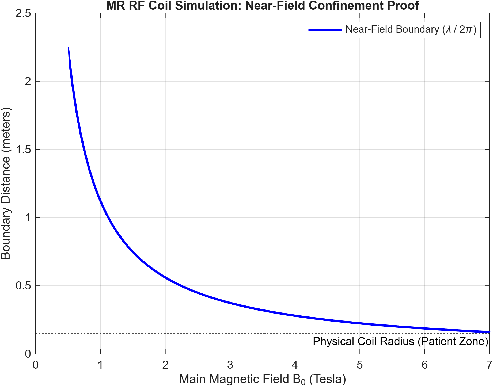
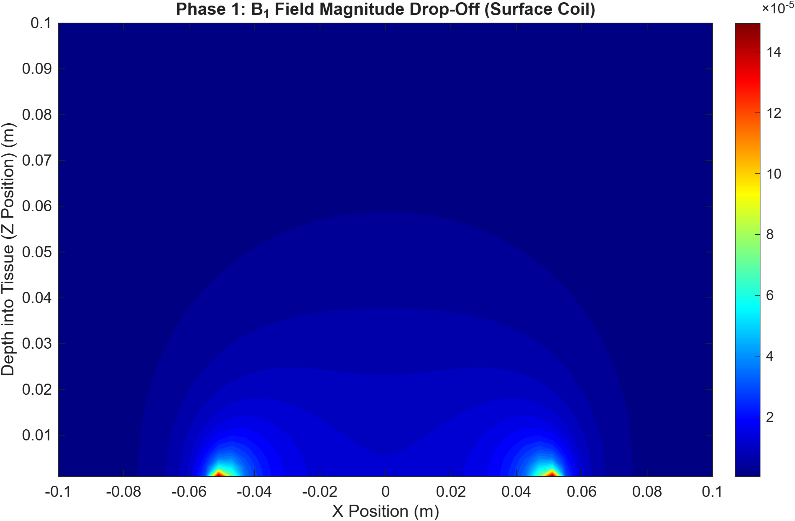
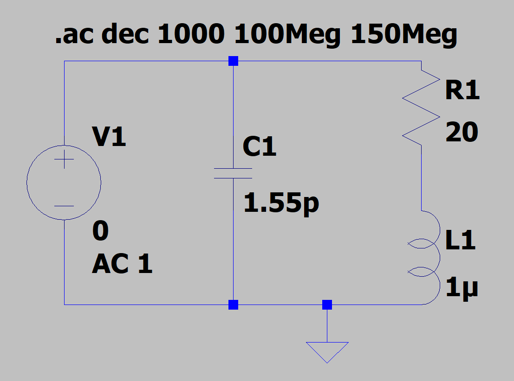
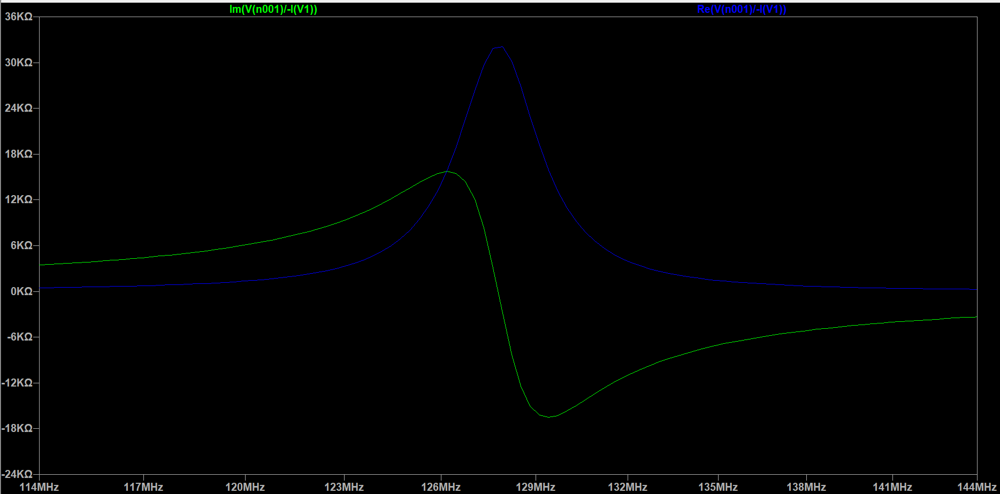
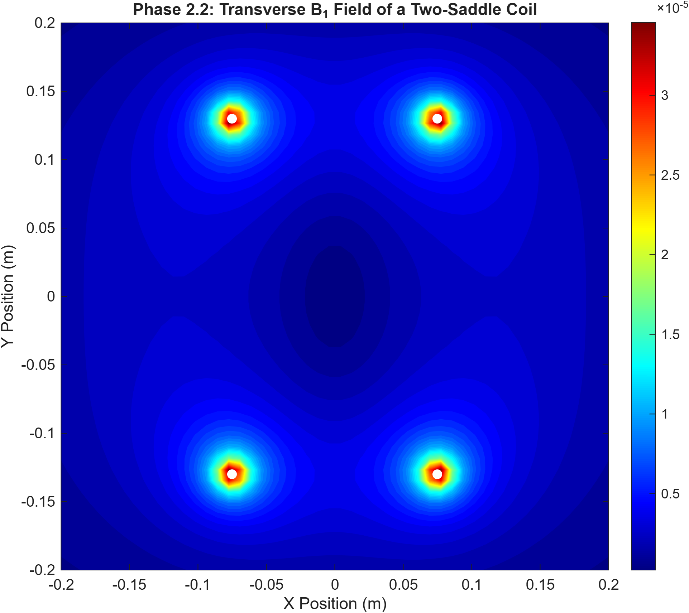
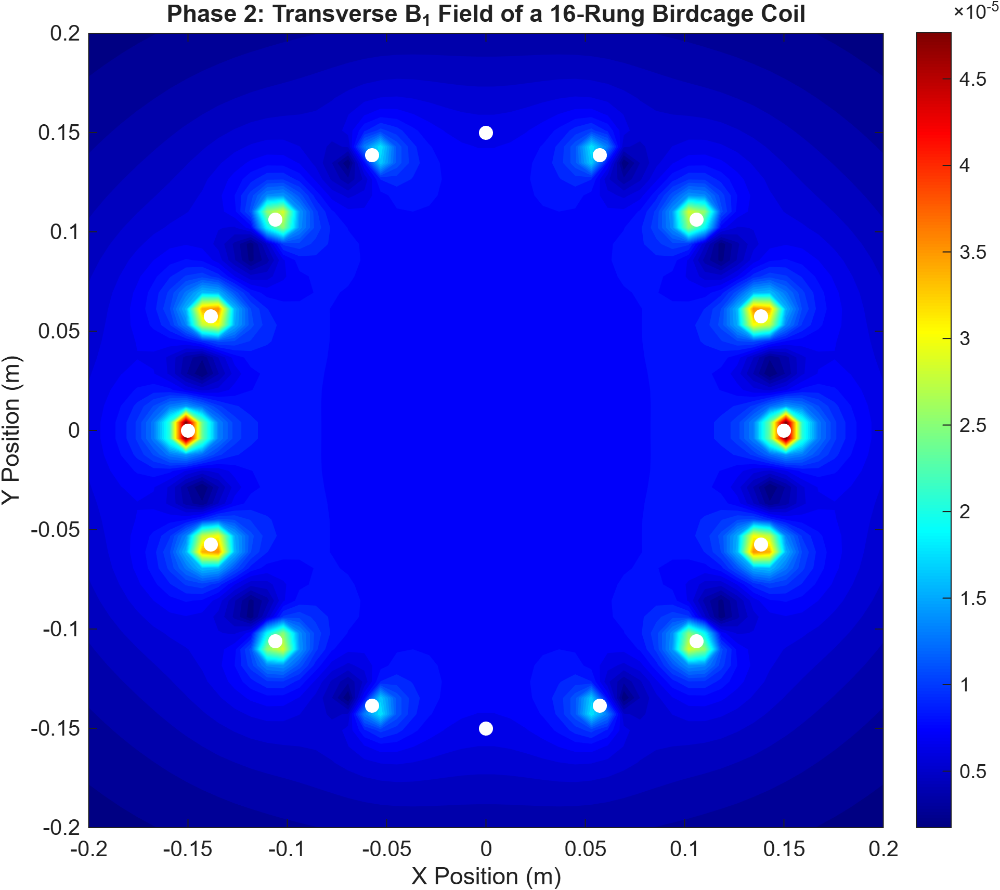
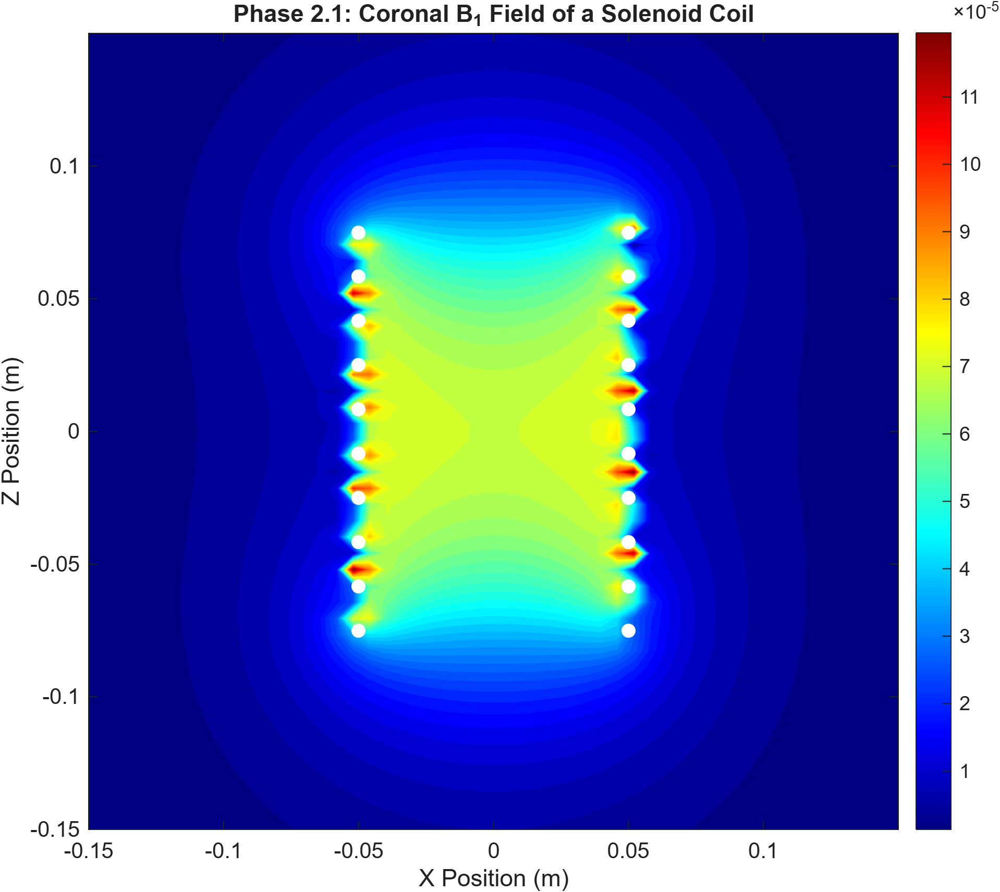

# MR RF Coil Simulation

This repository contains custom MATLAB-based numerical solvers for simulating the electromagnetic properties of Magnetic Resonance (MR) Radiofrequency (RF) coils. Unlike traditional antennas that radiate into the far-field, MR coils are designed to operate exclusively in the near-field. This project mathematically maps these environments without relying on proprietary commercial toolboxes.

## Fundamental Proof: Near-Field Confinement
Before mapping specific coil geometries, it is necessary to mathematically prove why this repository relies on the classical static Biot-Savart law rather than full-wave radiation models. 

In *Modern Electrodynamics* (Zangwill, 2013), the near-zone (quasistatic region) for an oscillating source is defined by the characteristic time boundary:

$$ r \ll c\tau $$

For an MR RF coil driven by a continuous harmonic oscillation, the characteristic time $\tau$ is the inverse of the angular frequency ($\frac{1}{\omega}$). Substituting this reveals the physical radiansphere limit:

$$ r \ll \frac{c}{\omega} \rightarrow r \ll \frac{c}{2\pi f} \rightarrow r \ll \frac{\lambda}{2\pi} $$

Because the physical radius of clinical MR hardware remains significantly smaller than the RF wavelength across the entire clinical magnetic field spectrum (0.5T to 7T), the hardware functions as an *electrically small* antenna. This sub-wavelength reality strictly invalidates the far-field Fraunhofer distance ($2D^2 / \lambda$) and confines the patient zone entirely within the reactive near-field. Because the signal propagates across the patient's tissue practically instantaneously, time-retardation is negligible, mathematically clearing us to reduce complex time-dependent Maxwell equations down to classical Biot-Savart numerical solvers.

  

## Surface Coil
A 3D numerical solver built from scratch to calculate the B1 magnetic field distribution of a circular surface coil. The simulation mathematically proves why a surface coil has high signal near the wire but rapid signal drop-off deeper in the tissue.

  

A simplified model of this surface coil configuration can be simulated in LTspice with the corresponding impedance plot for resonant frequency at 3T.

  
  &nbsp;&nbsp;&nbsp;&nbsp;
  

## The Two-Saddle Coil 
This phase simulates the classic 120-degree two-saddle (Golay) coil, the industry-standard baseline for volume imaging before the birdcage architecture became dominant. The transverse field mapping illustrates that while the geometry provides excellent central signal penetration, the field homogeneity drops off rapidly near the physical edges of the arcs.

  

## The Birdcage Volume Coil
Moving beyond single loops, this phase simulates a 16-rung Birdcage volume coil—the industry standard for clinical head scans. By driving the individual rungs with specific phase shifts, the solver demonstrates how the coil creates a highly homogenous, circularly polarized B1 field inside the cylinder.

  

## The Solenoid Coil 
A numerical solver mapping the continuous helical geometry of a 10-turn solenoid. By mathematically stacking multiple circular loops continuously along the Z-axis, the simulation demonstrates how the magnetic fields add constructively to create an intense, highly uniform longitudinal B1 field. Due to this efficiency, this architecture is primarily utilized in high-field, preclinical small-animal MRIs where the subject fits entirely within the compact cylindrical bore.

  

## References
* Webb, A (2016). *Magnetic Resonance Technology: Hardware and System Components*. Royal Society of Chemistry
* Xia, Y. (2022). *Essential Concepts in MRI: Physics, Instrumentation, Spectroscopy, and Imaging* (1st ed.). Wiley.
* Zangwill, A. (2013). *Modern Electrodynamics*. Cambridge University Press.
* Jin, J.-M. (2015). *Theory and Computation of Electromagnetic Fields*. John Wiley & Sons.
